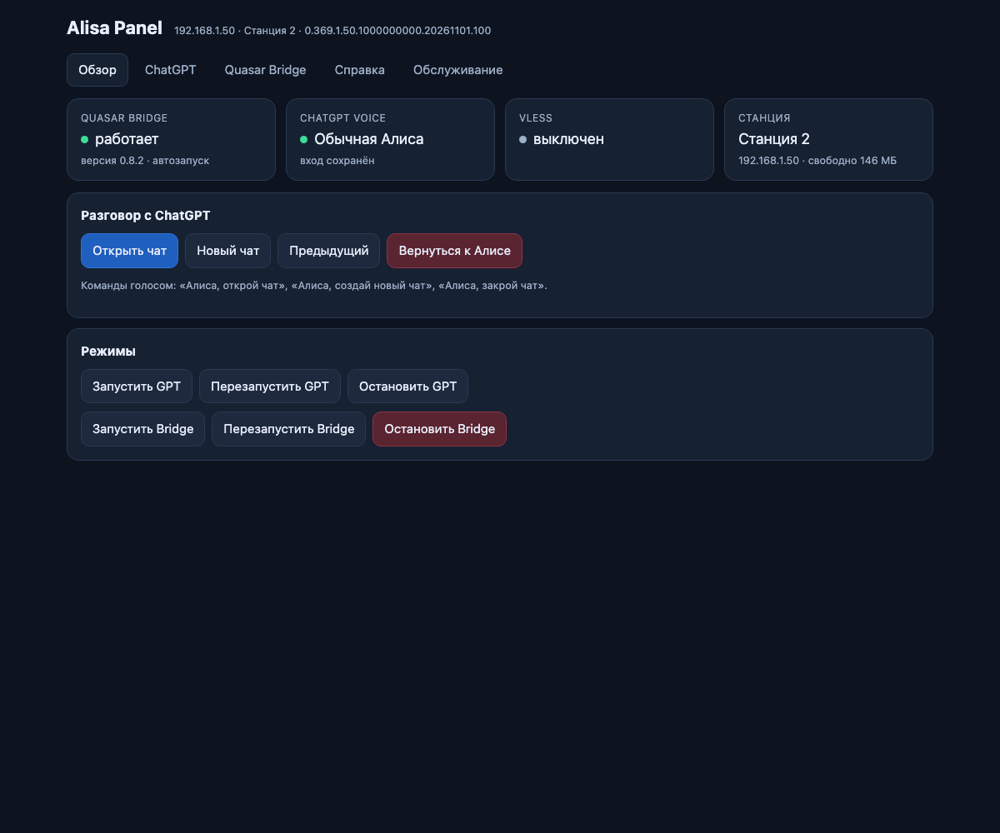
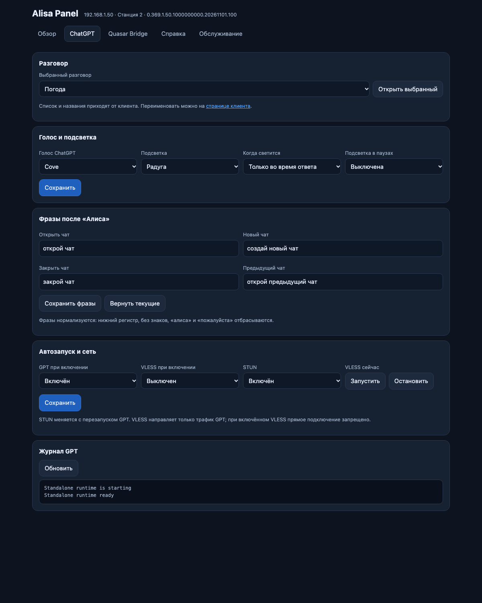
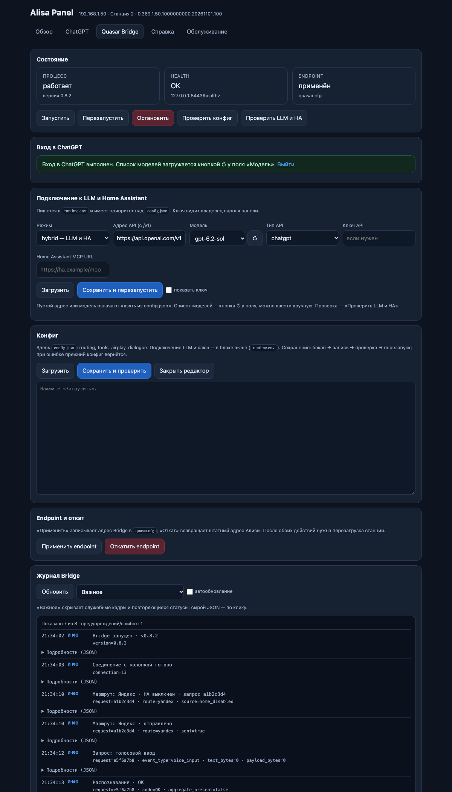
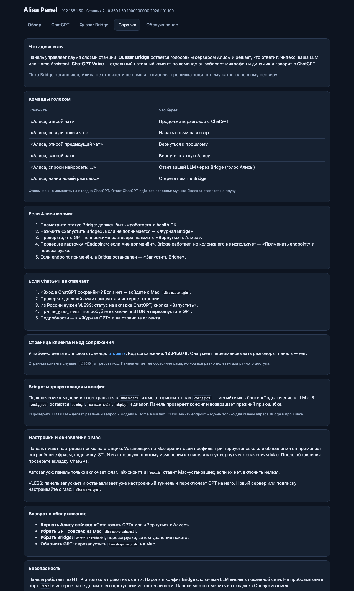

# HackAlice Toolkit

Панель и установщик для рутованной **Яндекс Станции**: [Quasar Bridge](https://github.com/skrashevich/quasar-bridge)
(ответы своей LLM голосом Алисы), [ChatGPT Voice](https://github.com/rison1337/Alisa-ChatGPT-voice-assistant)
(нативный голосовой ChatGPT на колонке) и локальная **веб-панель** для управления обоими.

Один `install.sh` на macOS или Linux ставит всё по SSH. Windows — только WSL. Панель живёт на станции и открывается
из локальной сети.

> **Проверено только на Яндекс Станции 2** (внутреннее имя `yandexmidi`), прошивка
> `0.369.1.46`/`0.369.1.50`. Другие модели — Лайт, Мини, Миди, Макс — **не
> тестировались**. Проект неофициальный, с Яндексом не связан; всё делается на своих
> устройствах и на свой риск.

> **Сначала root и SSH.** Установщик работает только по SSH с правами root.
> Получите root и включите SSH по [инструкциям hackalice.me](https://hackalice.me/start/):
> без этого установщик не подключится к станции.



Скриншоты — демонстрационные данные, не с реальной станции.

## Что это

| Компонент | Что делает | Где работает |
|---|---|---|
| **Quasar Bridge** | Оставляет голос Алисы, но сложные вопросы отдаёт своей LLM, а умный дом — Home Assistant | На станции |
| **ChatGPT Voice** | Нативный клиент: по «Алиса, открой чат» микрофон и динамик переходят к ChatGPT | На станции; установка с Mac |
| **Alisa Panel** | Веб-панель: статус, запуск/остановка, настройки, журналы и справка | На станции, `:8099` |

Bridge и GPT работают вместе: Bridge — голосовой сервер Алисы, GPT перехватывает
разговор. Панель показывает зависимость и предупреждает, если endpoint не применён
или Bridge остановлен.

## Возможности панели

- **Обзор**: статусы Bridge/GPT/VPN, «Открыть чат», «Новый чат», «Вернуться к Алисе»,
  запуск/остановка/перезапуск.
- **ChatGPT**: разговоры, голос, подсветка, фразы после «Алиса», автозапуск, STUN,
  VLESS, журнал. Одна общая кнопка «Сохранить» на блок «Голос и подсветка» и на блок
  «Автозапуск и сеть».
- **Quasar Bridge**: процесс, health, endpoint, старт/стоп/перезапуск, проверки LLM/HA,
  поля подключения из `runtime.env`, редактор `config.json`, apply/rollback endpoint.
  Модель выбирается из подсказок: кнопка ↻ загружает `/models`, иначе типовые значения
  и ручной ввод.
- **Читаемый журнал Bridge**: время, уровень, понятное событие; фильтры
  «Важное / Все / только ошибки», автообновление, сырой JSON по клику.
- **Справка** и **обслуживание**: смена пароля, перезагрузка, диагностика.




<details>
<summary>Встроенная справка</summary>


</details>

Подробнее: [README-panel.md](README-panel.md).

## Требования

- **Яндекс Станция 2** с уже полученным root и включённым SSH, доступная из сети компьютера.
  Инструкции: [hackalice.me/start](https://hackalice.me/start/). Для панели нужен
  Entware (пакеты `lighttpd`, `curl` установщик поставит сам).
- **macOS или Linux** (Windows — WSL) с Python 3.10+, `curl`, `ssh`, `tar`.
  Для входа: macOS — Chrome/Edge/Chromium; Linux — Chromium, Xvfb, xauth.
- **Аккаунт ChatGPT** с доступным голосовым режимом.
- Для Bridge — LLM с OpenAI-совместимым API (адрес, модель, ключ) и, по желанию,
  Home Assistant с MCP.
- Для GPT из России — рабочий VLESS (настраивается в мастере).

## Перед установкой: root и SSH

Без root и SSH установщик не сможет подключиться. Порядок:

1. [С чего начать](https://hackalice.me/start/) — выберите способ для своей модели.
2. [Получение root](https://hackalice.me/start/root/) — для Станции 2 и большинства
   моделей это подмена DNS.
3. [SSH и отключение обновлений](https://hackalice.me/start/ssh/) — поставьте SSH и
   заблокируйте OTA, чтобы доступ не пропал.

Проверьте доступ с компьютера:

```sh
ssh -p 2222 root@SPEAKER_IP 'id -u'
```

Ожидается `0`. Если команда не работает, сначала пройдите инструкции выше — установщик
не сможет подключиться.

## Быстрый старт

Перед установкой получите root и SSH — [инструкции hackalice.me](https://hackalice.me/start/).

```sh
git clone https://github.com/alebastr12/hackalice-toolkit.git
cd hackalice-toolkit
./install.sh --host SPEAKER_IP --ssh-port 2222
```

`SPEAKER_IP` замените на адрес станции. Установщик идёт по шагам:

1. **Quasar Bridge** — если ещё не стоит, скачает официальный установщик и запустит
   мастер: адрес API, модель, ключ, Home Assistant MCP. Можно отказаться от
   переключения endpoint и сделать это позже в панели.
2. **ChatGPT Voice** — на macOS поставит CLI и применит патч к релизу 0.3.11; на Linux
   скачает официальный Linux-релиз (`bootstrap-linux.sh`, патч не нужен). Затем мастер:
   нативный режим, IP/порт/пароль SSH, VLESS, автозапуск, подсветка, вход в ChatGPT
   в браузере и голосовой тест.
3. **Панель** — поставит lighttpd/curl через Entware, создаст автозапуск и напечатает
   адрес, логин и пароль.

После установки откройте `http://SPEAKER_IP:8099/`, логин `admin`, пароль — из вывода
установщика. Пароль хранится на станции в `/data/opt/alisa-panel/panel.conf` (0600),
меняется во вкладке «Обслуживание».

### Только панель

```sh
./install-panel.sh --host SPEAKER_IP --ssh-port 2222
```

### Только ChatGPT Voice

macOS:

```sh
./bootstrap-macos.sh
```

Linux (официальный upstream, без macOS-патча):

```sh
curl -fsSL https://raw.githubusercontent.com/rison1337/Alisa-ChatGPT-voice-assistant/main/bootstrap-linux.sh | sh
```

Нужны x86_64, Python 3.10+, Chromium, Xvfb и xauth. Windows — официальный пакет из
[релизов upstream](https://github.com/rison1337/Alisa-ChatGPT-voice-assistant/releases/latest)
(`START-WINDOWS.cmd`).

### Только Quasar Bridge

```sh
curl -fL -o /tmp/install-quasar-bridge.sh \
  https://github.com/skrashevich/quasar-bridge/releases/latest/download/install.sh && \
  sh /tmp/install-quasar-bridge.sh root@SPEAKER_IP -p 2222
```

### Флаги общего установщика

`--skip-bridge`, `--skip-voice`, `--skip-panel`, `--bridge` (переустановить Bridge),
`--voice` (переустановить GPT), `--panel-port`, `--identity`. Полный список: `./install.sh --help`.

## Linux и Windows

- **Linux:** `./install.sh` работает; GPT ставится официальным `bootstrap-linux.sh`
  (x86_64, Python 3.10+, Chromium, Xvfb, xauth). macOS-патч не нужен; панель —
  `./install-panel.sh`.
- **Windows:** нативно не поддерживается. Используйте WSL (Ubuntu) для Bridge и
  панели, а для GPT — официальный Windows-пакет upstream. В Git Bash/MSYS установщик
  остановится и попросит WSL.
- **Только панель** на Linux/WSL: `./install-panel.sh --host SPEAKER_IP --ssh-port 2222`.

## Панель

Панель работает на станции: статический HTML + CGI на shell + `lighttpd` из Entware.
Без внешних CDN и JS-библиотек. Доступ только из приватных сетей
(`127.0.0.1`, `192.168/16`, `10/8`, `172.16/12`), Basic-авторизация и CSRF-токен на
все POST. HTTP без TLS: пароль и ключи LLM видны в локальной сети — не пробрасывайте
порт в интернет и не открывайте из гостевой сети.

Проверено на живой Станции 2: 401/200, смена пароля из панели, `bridge_check`,
`S99zz-alisa-panel stop/start`, читаемый журнал, общий «Сохранить»; 18 тестов API.
Вход в ChatGPT и голосовой диалог выполняет владелец колонки.

Основной прогон — macOS. Linux-ветка общего установщика добавлена, но на живой Linux
не проверялась; Windows поддерживается только через WSL.

## Ограничения

- Только **Станция 2** (`yandexmidi`). На Лайт/Мини/Миди/Макс не проверялось.
- Bridge и GPT — сторонние проекты; их поддержка и совместимость с прошивками — на
  стороне этих проектов. Наш пакет не пересобирает ARM-клиент и не меняет прошивку.
- macOS-патч привязан к ChatGPT Voice **0.3.11**; для новой версии нужен обновлённый
  патч (`scripts/build-macos-patch.sh`).
- Вход/выход ChatGPT — только с компьютера (macOS/Linux, `alisa native login`/`logout`);
  панель не хранит пароль и не логинится.
- Панель — HTTP в локальной сети; не является заменой VPN/HTTPS.
- Quasar Bridge и ChatGPT Voice могут перезаписывать часть настроек при обновлении с
  компьютера; после обновления проверьте вкладку ChatGPT.
- Linux-ветка не проверялась на живой Linux; Windows — только WSL (нативный
  установщик не поддерживается).

## Обновление и удаление

- Обновить всё: повторить `./install.sh` (установленное пропускается; `--voice`/`--bridge`
  — принудительно).
- Удалить панель: `./install-panel.sh --uninstall` (или `--uninstall --keep`).
- Удалить GPT: `~/.local/bin/alisa native uninstall`.
- Убрать Bridge: `control.sh rollback`, перезагрузка, затем удаление пакета.
- Пакеты `lighttpd`/`curl` из Entware после удаления панели остаются; удаляйте вручную,
  только если они больше нигде не нужны.

## Ссылки и благодарности

**Репозитории:**

- [rison1337/Alisa-ChatGPT-voice-assistant](https://github.com/rison1337/Alisa-ChatGPT-voice-assistant) —
  нативный ChatGPT Voice для Станции (наша macOS-часть — патч к его релизу).
- [skrashevich/quasar-bridge](https://github.com/skrashevich/quasar-bridge) — Quasar Bridge
  (Apache-2.0), устанавливается официальным установщиком.
- [Marker284/yandex-station-extended](https://github.com/Marker284/yandex-station-extended) —
  вики по root и модификациям; сайт [hackalice.me](https://hackalice.me).
- [Entware](https://github.com/entware/entware) — пакеты для станции (`lighttpd`, `curl`).

**Сервисы и технологии:**

- [ChatGPT](https://chatgpt.com) — голосовой режим и аккаунт.
- [OpenAI API](https://platform.openai.com/docs) — OpenAI-совместимый API для Bridge.
- [Home Assistant](https://www.home-assistant.io) — умный дом через MCP (опционально).
- [Яндекс Алиса](https://alice.yandex.ru) — голосовой тракт станции.
- [lighttpd](https://www.lighttpd.net), [BusyBox](https://busybox.net),
  [Python](https://www.python.org), [Google Chrome](https://www.google.com/chrome) —
  рантайм панели и установщика.

Спасибо авторам upstream-проектов и сообществу [@hackalice](https://t.me/hackalice).

## Разработка

```sh
python3 -m unittest discover -s panel/tests -v
python3 -m unittest discover -s macos/tests -v
```

`macos/tests/test_bootstrap.sh` проверяет установку из локального архива
(`ALISA_TEST_ARCHIVE=/path/to/alisa-voice-linux.tar.gz`).

Пересобрать macOS-патч: склонируйте upstream в `repo/`, внесите правки и выполните
`./scripts/build-macos-patch.sh`.

## Лицензия

Код панели и установщиков — MIT (см. [LICENSE](LICENSE)). Патч применяется к
upstream-релизу ChatGPT Voice; права на upstream-код принадлежат его авторам.
Quasar Bridge распространяется по Apache-2.0. Проект неофициальный и не связан с
Яндексом, OpenAI или авторами upstream.
